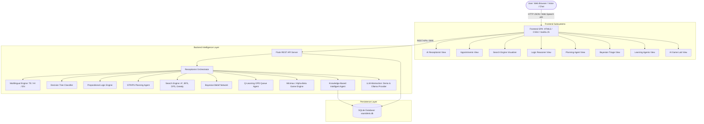

# System Architecture & Technical Specifications — VaaniDesk AI

---

## Technical Specifications

| Component | Technology | Description |
| :--- | :--- | :--- |
| **Backend Framework** | Python 3.10+ / Flask 3.1+ | Lightweight RESTful routing, CORS support, static file hosting. |
| **Persistence** | SQLite 3 (`backend/data/vaanidesk.db`) | Relational persistence with auto-seeding for departments, doctors, slots, appointments, FAQs, and policies. |
| **Machine Learning** | Scikit-Learn / NumPy | Supervised Decision Tree classifier (`criterion='entropy'`) with sublinear TF-IDF n-grams. |
| **Search & Graph** | Pure Python Standard Library | Breadth-First, Depth-First, Greedy Best-First, A\*, Hill Climbing, and Beam Search. |
| **Planning** | STRIPS Forward Search | Precondition-Action-Effect state space search for appointment workflows. |
| **Probabilistic Inference**| Exact Bayes Theorem | Conditional Probability Tables (CPTs) evaluating symptom posteriors $P(\text{Risk}\mid E)$. |
| **Game Search** | Alpha-Beta Pruning | Adversarial 2-player zero-sum game tree search. |
| **Frontend** | Vanilla JavaScript / Modern CSS3 | Zero frontend build step, native Web Speech API (STT/TTS), glassmorphism design. |
| **Testing** | Pytest 8+ | 26 automated unit and integration tests covering all routes and AI modules. |
